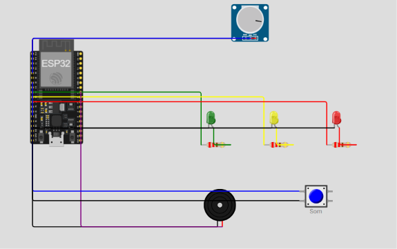

# 🌎 Hearmony — Monitoramento inteligente de ruído

## 📌 Sobre o projeto

O **Hearmony** é um projeto de tecnologia assistiva criado para apoiar pessoas que sentem desconforto, estresse ou sobrecarga sensorial diante de sons intensos ou imprevisíveis. O grupo busca explorar como a tecnologia pode oferecer mais autonomia e uma experiência sonora mais confortável, sem simplesmente eliminar sons importantes para a orientação e a segurança.

A proposta se relaciona à **Citizen Tech** por colocar inclusão, acessibilidade e qualidade de vida no centro da solução. O sistema pretende identificar estímulos sonoros desconfortáveis e permitir uma resposta ajustável às necessidades de cada pessoa, sem se limitar a um diagnóstico específico e sem substituir acompanhamento especializado.

O objetivo de longo prazo é combinar detecção sonora, limites personalizados e resposta adaptativa. No protótipo atual, um potenciômetro representa manualmente uma escala de 0 a 100 pontos: o Wokwi não oferece neste circuito um medidor de decibéis ou de ruído. Portanto, essa entrada não mede som real. O protótipo demonstra a lógica de decisão local, não a medição acústica nem a atenuação de áudio.

---

## 📷 Vídeo de apresentação

[Assista à apresentação do Hearmony no YouTube](https://youtu.be/YAFtddJl21g)

---

## 🎯 Objetivos

* Representar diferentes níveis de desconforto sonoro por meio de uma escala simulada;
* Classificar a leitura em conforto, atenção e proteção;
* Sinalizar cada estado com LEDs e alertas sonoros;
* Permitir o ajuste do limite de resposta;
* Manter a decisão local do ESP32 quando a conexão estiver indisponível;
* Compartilhar telemetria e comandos com os demais módulos do projeto;
* Guardar um histórico local das leituras recebidas pelo cliente Python.

---

## 🌐 Como as partes do Hearmony se relacionam

O projeto reúne módulos com responsabilidades diferentes. O **ESP32** recebe a entrada simulada e decide localmente como sinalizar cada estado. O **broker MQTT EMQX Cloud** encaminha as leituras e os comandos entre os dispositivos. O **cliente Python** acompanha os dados, publica limites e mantém o histórico neste computador. A interface Web faz parte da solução global e está sendo desenvolvida em outro módulo do projeto.

```text
Potenciômetro → ESP32 / Edge → EMQX Cloud → Cliente Python e interface Web
                    ├─ LEDs e buzzer: resposta local
                    └─ decisão continua ativa sem internet
```

A conexão com a nuvem amplia o acompanhamento, mas não controla a decisão imediata do ESP32. Assim, o processamento local representa o papel de Edge Computing dentro da proposta assistiva.

---

## 🔗 Simulação no Wokwi

[Abrir o projeto Hearmony no Wokwi](https://wokwi.com/projects/479326589809502209)

---

## 📷 Circuito



---

## 🛠️ Componentes utilizados

| Componente | Função no protótipo |
|---|---|
| ESP32 | Lê a escala simulada, decide localmente e se comunica por MQTT |
| Potenciômetro | Simula manualmente o nível de ruído de 0 a 100 pontos |
| LED verde | Indica conforto |
| LED amarelo | Indica atenção |
| LED vermelho | Indica proteção |
| Buzzer | Emite alertas sonoros conforme o estado |
| Botão | Ativa ou silencia os alertas sonoros |

---

## ⚙️ Como funciona

1. O potenciômetro fornece um valor simulado entre 0 e 100 pontos.
2. O ESP32 compara esse valor com o limite configurado.
3. O firmware classifica a leitura como conforto, atenção ou proteção.
4. Os LEDs e o buzzer sinalizam o estado sem depender da internet.
5. Quando há conexão, o ESP32 publica a telemetria no broker MQTT.
6. O cliente Python recebe as leituras, permite publicar um novo limite e registra o histórico local.

A leitura atual fica retida no broker. Para guardar as mensagens recebidas ao longo do tempo, o cliente Python precisa permanecer aberto.

---

## 🚀 Como executar

### Cliente Python

Use Python 3.10 ou superior. Copie `python/.env.example` para `python/.env`, preencha as credenciais MQTT do usuário Python e instale as dependências:

```powershell
py -3 -m pip install -r python\requirements.txt
py -3 python\client.py
```

### Simulação no Wokwi

Abra o projeto pelo link acima. O circuito usa a biblioteca `PubSubClient`, indicada em `hearmony-wokwi/libraries.txt`. Para conectar ao broker, configure as credenciais MQTT do dispositivo e o certificado CA no firmware. Não publique credenciais reais em um projeto aberto.

---

## 📂 Estrutura do projeto

```text
python/                 Cliente MQTT, simulação e histórico local
hearmony-wokwi/         Firmware ESP32, circuito e biblioteca MQTT
circuito.png            Imagem do circuito do protótipo
materiaisdeaula/        Materiais de aula
README.md               Apresentação geral do projeto
```

---

# 👥 Equipe

* Luiz Alberto De Carvalho Holanda Junior
* Felipe Ribeiro Da Silva
* Milena Kubo de Biaggi
* Yasmim Eun Hae Kim
* Thiago Fernandes Kulesza

---

## 📄 Licença

Projeto acadêmico desenvolvido para a Global Solution da FIAP, dentro da proposta Citizen Tech.