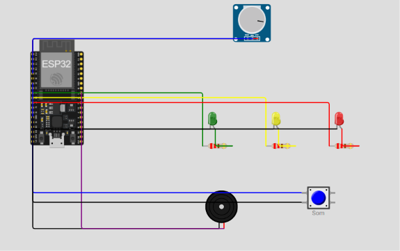

# 🔌 Hearmony — Edge Computing e circuito Wokwi

## 📌 Sobre o protótipo

O Hearmony busca apoiar pessoas que sentem desconforto, estresse ou sobrecarga sensorial em ambientes ruidosos. A proposta valoriza autonomia, inclusão e acessibilidade: uma resposta sonora deve considerar o conforto sem eliminar sons importantes para a orientação e a segurança.

Esta pasta reúne a demonstração da camada **Edge Computing**. O ESP32 analisa a entrada, escolhe um estado e aciona LEDs e buzzer localmente. A decisão continua ativa mesmo se Wi-Fi ou broker estiverem indisponíveis; a conexão MQTT serve para compartilhar telemetria e receber limites.

No Wokwi, usamos um potenciômetro porque o simulador não oferece neste circuito um medidor de decibéis ou de ruído. Ele representa manualmente uma escala de 0 a 100 pontos; não é microfone e não mede som real. Assim, a simulação demonstra o ciclo de leitura, decisão e alerta, não a detecção acústica nem a atenuação de áudio planejadas como objetivo de longo prazo.

---

## 🎯 Objetivos do módulo Edge

* Simular diferentes níveis de desconforto sonoro;
* Classificar a entrada em conforto, atenção e proteção;
* Dar uma resposta visual e sonora imediata;
* Continuar operando localmente sem depender da internet;
* Enviar leituras ao Python por MQTT e receber limites atualizados.

---

## 🔗 Simulação e apresentação

* [Abrir o projeto Hearmony no Wokwi](https://wokwi.com/projects/479326589809502209)
* [Assistir ao vídeo de apresentação no YouTube](https://youtu.be/YAFtddJl21g)

---

## 📷 Circuito



---

## 🛠️ Componentes utilizados

| Componente | Ligação | Papel no protótipo |
|---|---|---|
| ESP32 | GPIO 34, 25–27, 18 e 32 | Lê a entrada, decide e controla os alertas |
| Potenciômetro | GPIO 34, 3V3 e GND | Ajusta a escala simulada de ruído |
| LED verde | GPIO 25 e resistor de 220 Ω | Indica conforto |
| LED amarelo | GPIO 26 e resistor de 220 Ω | Indica atenção |
| LED vermelho | GPIO 27 e resistor de 220 Ω | Indica proteção |
| Buzzer | GPIO 18 e GND | Emite alerta sonoro |
| Botão | GPIO 32 e GND | Ativa ou silencia os alertas sonoros |

---

## ⚙️ Funcionamento

1. O potenciômetro fornece um valor entre 0 e 100 pontos.
2. O ESP32 compara a leitura com o limite atual e classifica o estado.
3. Os LEDs indicam o estado; o buzzer pode ser silenciado pelo botão.
4. Quando a conexão está disponível, o firmware publica a telemetria no tópico `hearmony/device/hearmony-01/telemetry`.
5. O firmware assina `hearmony/device/hearmony-01/commands` e aplica o novo limite recebido.

O ESP32 publica uma leitura no início, quando o estado muda e periodicamente. A leitura mais recente fica retida no broker; o histórico completo é registrado pelo cliente Python enquanto ele estiver em execução.

---

## 🚀 Como abrir e configurar

O projeto está disponível pelo link do Wokwi acima. A biblioteca `PubSubClient` está indicada em `libraries.txt`; o simulador usa a rede `Wokwi-GUEST`.

Para usar MQTT, o firmware precisa das credenciais do usuário Edge, do host EMQX e do certificado CA configurados em `sketch.ino`. Mantenha as credenciais privadas e restritas aos tópicos deste dispositivo. Em uma placa física, configure também `WIFI_SSID` e `WIFI_PASSWORD`; a rede precisa permitir conexões de saída pela porta TCP `8883`.

### Dashboard Edge local

O dashboard desta pasta acompanha a telemetria do ESP32, mostra o estado atual e o histórico local, e permite enviar um novo limite pelo broker MQTT. Ele reutiliza o cliente e as dependências MQTT da pasta `python/`.

Configure `python/.env` com as credenciais do usuário MQTT Python e instale as dependências conforme as instruções em [python/README.md](../python/README.md). Na pasta principal do projeto, inicie o dashboard:

```bash
python hearmony-wokwi/dashboard.py
```

No Windows, use `py -3 hearmony-wokwi\dashboard.py`. Em seguida, abra [http://127.0.0.1:8080](http://127.0.0.1:8080) no navegador. O dashboard usa o mesmo identificador MQTT do cliente de terminal; execute apenas um deles por vez. O servidor fica acessível somente no próprio computador.

---

## 🤖 Declaração de Uso de IA (Inteligência Artificial)

Em conformidade com os critérios éticos e diretrizes acadêmicas da Sprint 4, declaramos que a Inteligência Artificial foi utilizada exclusivamente nas seguintes situações:

* Criação e formatação deste README;
* Revisão geral do projeto;
* Auxílio pontual na identificação e resolução de bugs.

---
# 👥 Equipe

* Luiz Alberto De Carvalho Holanda Junior — RM 573843
* Felipe Ribeiro Da Silva — RM 573818
* Milena Kubo de Biaggi — RM 572590
* Yasmim Eun Hae Kim — RM 571494
* Thiago Fernandes Kulesza — RM 568922

